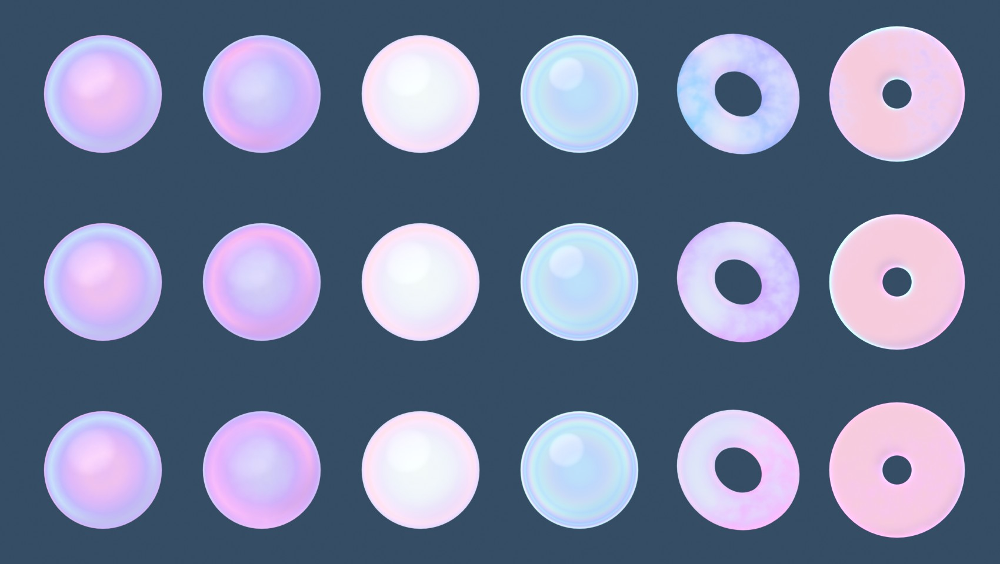

# LidaAuroraToon

Blender（EEVEE）用のトゥーンシェーダーです。[LidaAngelToon](https://github.com/Lida-V/LidaAngelToon) のやわらかい 2 段の影を土台に、人魚のひれ・うろこ・貝殻・真珠・髪に使う次の表現を足しました。

- **真珠層の虹色**：見る角度で色相が移る、貝殻の内側のような色
- **オーロラの光**：帯が流れる、または縦のひだがカーテンのようにはためく自己発光
- **透明感**：薄い所ほど透ける、縁が残る、裏からの光が抜ける
- **髪の輪郭の光**：髪の束の輪郭に出るやわらかい光。見る角度・場所・時間で色が移る
- **全体のつまみ**：強さ・速さ・色をまとめて変える

A soft toon shader for Blender (EEVEE): nacre iridescence, flowing or curtain-like aurora light, thickness-based translucency, a soft glow on the outline of hair locks, and master sliders. Built on the Blender add-on of LidaAngelToon. Japanese first; the input list is in [docs/INPUTS.md](docs/INPUTS.md).



左から `shell`・`scale`・`pearl`・`gem`・`fin`・`hair_softglow`。上から 1・72・144 コマ目（24 fps）で、オーロラと髪の光が時間で移ります。原始図形に単色を置いただけの見本です（`tools/render_readme.py` で描けます）。

## 対象

| 項目 | 状態 |
| --- | --- |
| Blender 5.3 / EEVEE | 原始図形とキャラクターモデルの背景実行（`-b`）の描画で確認 |
| ビューポートでの操作 | 作者側の機械的な確認はしていません（描画の結果だけ確かめました） |
| Blender 5.2 以前 | 未確認。灯りは自動で「太陽 1 つをドライバーで読む方式」になります |
| アドオンとしての導入 | 未確認（下の「導入せずに使う」は確認済み） |
| Cycles | 未対応（EEVEE 専用） |
| VRM・Unity・Unreal Engine | 未対応。VRM は MToon になり、この見え方は持って行けません |

色の変換は Standard で値を決めています（AgX では淡くなります）。

## 使い方（導入せずに使う）

```python
import sys, bpy
sys.path.insert(0, r"<このリポジトリ>/blender")
from lida_aurora_toon import shader

scene = bpy.context.scene
sun = shader.ensure_sun(scene)                        # 太陽が無ければ 1 つ作る
mat = bpy.data.objects["Fin"].active_material         # Principled BSDF の材質

# ひれ：厚みを測ってから当てる（薄い所ほど透ける）
shader.bake_thickness(bpy.data.objects["Fin"], full_thickness=0.012)   # 12 mm 以上は透けない
shader.apply_material(mat, "fin", sun, thickness_attribute=shader.THICKNESS_ATTR)

# 貝殻・うろこ・真珠・髪
shader.apply_material(shell_mat, "shell", sun)
shader.apply_material(hair_mat, "hair_softglow", sun)

# 髪の光をにじませる（合成に Bloom を 1 つ作る。つまみ Glow が付く）
shader.ensure_glow(scene, strength=1.0, size=0.7)

# 元へ戻す（足したノードは残す）／足したノードも消す
shader.restore_material(mat)
shader.restore_material(mat, remove_nodes=True)
```

- 元の材質の基本色の画像・法線・Alpha を受け継ぎます。元のノードと出力は消しません。
- 材質 1 つに当てられるプリセットは 1 つです。1 つの材質の中に別の素材がある場合は、面を別の材質に分けるか、`Effect Mask` に画像や頂点の値をつなぎます。
- パネルをその場だけ出すには `blender <file.blend> --python tools/open_panel.py`（何も導入しません）。3D ビューのサイドバーに「LidaAuroraToon」が出ます。
- アドオンとして入れる場合は `blender/lida_aurora_toon` を ZIP にして入れます（この入れ方は未確認です）。

## プリセット

| 名前 | 用途 |
| --- | --- |
| `shell` | 貝殻・真珠層の板。正面から縁へ水色→青→紫→桃と移る |
| `fin` | ひれの膜。半透明、縁が残る、オーロラがはためく |
| `scale` | うろこ。基本色の明るさで 1 枚ずつ色相がずれる |
| `pearl` | 真珠。丸くやわらかい影、縁に虹色 |
| `gem` | 宝石・しずく。明るい芯、するどいつや |
| `hair_aurora` | 髪。面の上をオーロラが流れる |
| `hair_softglow` | `hair_aurora` に、束の輪郭のやわらかい光を足したもの |
| `hair_rimglow` `hair_glint` | 輪郭の光の硬い版、面の中に帯を出す版 |
| `skin` `face` `hair` `cloth` `metal` `eye` `mouth` `nail` | LidaAngelToon と同じ計算と値（MatCap なし） |

## 全体のつまみ

`apply_material` を呼ぶと、空の物体 `LidaAuroraToon Control` ができます。そのカスタムプロパティが、すべての材質にまとめて効きます。

| つまみ | 働き |
| --- | --- |
| `Aurora` / `Aurora Speed` | オーロラの強さ／速さ |
| `Iridescence` | 真珠層の虹色の強さ |
| `Glint` / `Glint Color` / `Glint Hue` / `Glint Speed` | 髪の輪郭の光の強さ／色の量（0＝白い光）／色ずらし／色と場所が移る速さ |
| `Shadows` | 1 で、すべての材質が落ち影を受ける |
| `Glow` | にじみの強さ（`ensure_glow` を呼んだときだけ） |

材質ごとの細かい値は、シェーダーエディターの LidaAuroraToon ノードの入力です。一覧は [docs/INPUTS.md](docs/INPUTS.md)。

## オーロラの流れ方

- `Aurora Curtain`：0 で帯が向きに沿って流れ、1 で縦のひだが横へはためきます。
- `Aurora Sway`：はためきの大きさ。
- `Aurora Noise`：0 で規則的な波、1 でひだの位置と濃さが不ぞろいになります（粒は足しません）。
- `Aurora Band Scale`：ひだの細かさ。`Aurora Speed`：速さ。

時計はシーンのカスタムプロパティ `lida_aurora_time`（ドライバー `frame / fps`）です。自動実行の許可は要りません。

## 灯り

- Blender 5.3 以上：Material Lighting ノードで、シーンのすべての灯り（色・減衰つき）を使います（`lighting='NODES'`、既定）。
- それ以前、または `lighting='DRIVER'`：太陽 1 つの向きと色をドライバーで読みます。

## 分かっている弱点

- 全体のつまみにキーを打って毎コマ動かすと、材質の作り直しが毎コマ起きて再生が重くなります（時計は別の仕組みなので、再生だけなら軽いままです）。
- にじみ（Glow）は Blender の合成の効果です。材質には入っていません。
- 尾びれのように横へ広がる面では、カーテンのひだがまっすぐな縦縞に見えることがあります。
- 半透明は `BLENDED`（同じ物体の一番手前の面だけ描く）です。重なった別の物体との前後は、物体単位で決まります。
- 元の材質が Alpha の画像を持つときは、その透けにプリセットの `Opacity` が重なります。画像の値の範囲を見て `Opacity` を上げてください。

## 試験

```
blender -b --factory-startup --python tests/blender_smoke.py
```

原始図形だけで、入力の数・ドライバー・時計・両方の灯りの方式・元へ戻す処理を確かめます。

## 出所とライセンス

- 土台は LidaAngelToon 0.2.1 の Blender アドオン（作者 Lida、GPL-3.0-or-later）。トゥーンの計算・輪郭線・肌や髪などのプリセットを写し、MatCap（画像）の入力は外しました。
- このリポジトリの Python は **GPL-3.0-or-later** です（`LICENSE`、`LICENSES/GPL-3.0-or-later.txt`）。
- キャラクターのモデル・テクスチャ・デザイン・モーションは含みません。
- シェーダーの素材に画像生成 AI は使っていません（同梱する画像は見本の描画 1 枚だけです）。

© 2026 Lida — <https://github.com/Lida-V/LidaAuroraToon>
